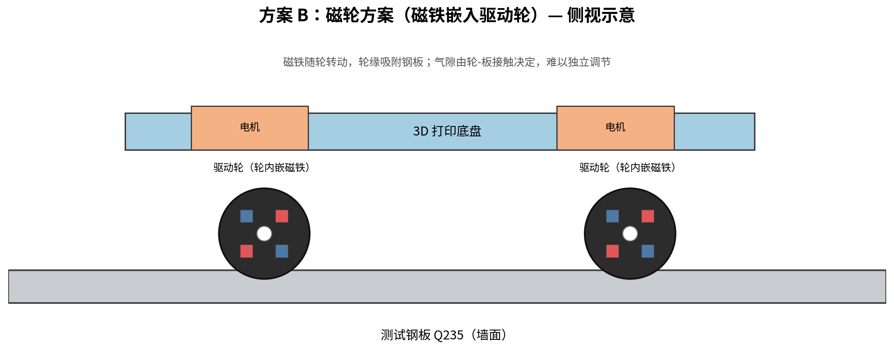
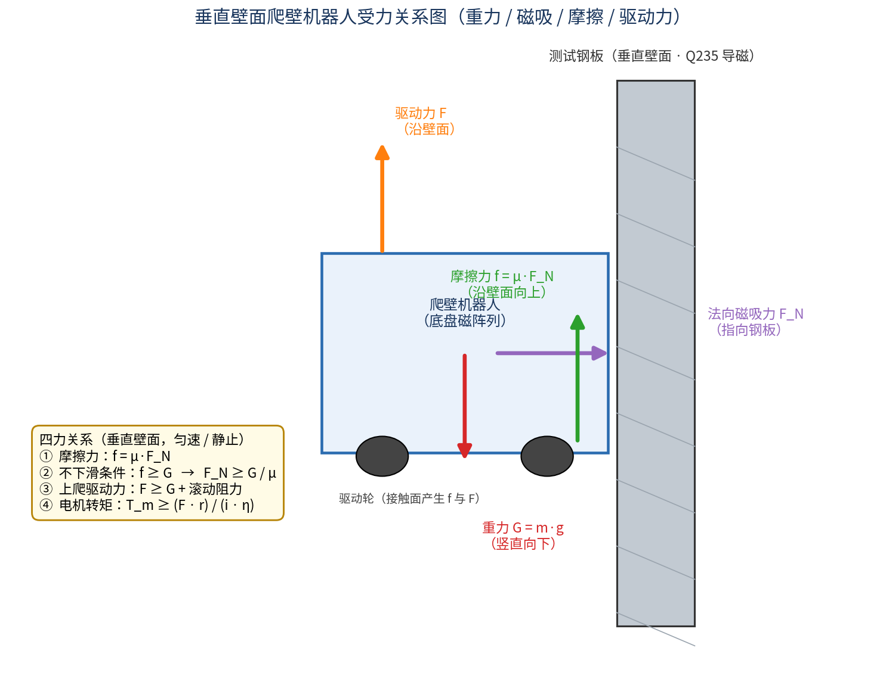
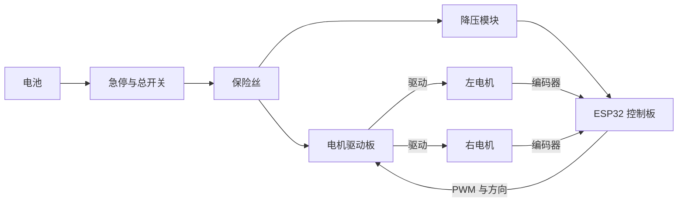

# 系统架构 — 赛道B 永磁吸附爬壁机器人

> 阶段：W1（五、六节为定性 v1，W2 补实测数值与引脚号）
> 负责人：何钰婷（Yuting1107）　|　分支：feat/w1-structure-v2
> 对应 Issue：#2（一～四节，钢板规格、两方案对比、质量估算与受力计算）、#4（五、六节，系统图定性和风险图）
> 钢板与台架参数来源：中心 2026-11-26 下发的定案（580×900 双板 + 4040 型材台架）。

## 内容与分工

| 节 | 负责人 | 对应 Issue |
| --- | --- | --- |
| 一、钢板规格与测试条件（任务 3） | 何钰婷 | #2 |
| 二、两套磁路方案对比（任务 4） | 何钰婷 | #2 |
| 三、质量估算（任务 5） | 何钰婷 | #2 |
| 四、受力计算（任务 6） | 何钰婷 | #2 |
| 五、系统图 v1（定性） | 徐佳惠 | #4 |
| 六、风险图（定性） | 徐佳惠 | #4 |
| 七、下一步与待补清单（W2 衔接） | 全组 | — |

---

## 一、钢板规格与测试条件（任务 3）

### 1.1 定案参数

| 项 | 主用板 | 对比板 |
| --- | --- | --- |
| 尺寸 | 580 × 900 mm | 580 × 900 mm |
| 厚度 | 5 mm | 3 mm |
| 材质 | Q235 冷轧 | Q235 冷轧 |
| 单块重量 | 20.5 kg | 12.3 kg |
| 数量 | 1 | 1 |

**重量核验**（Q235 密度取 7850 kg/m³）：

- 主用板：0.58 × 0.90 × 0.005 × 7850 = **20.49 kg**，与中心给的 20.5 kg 一致
- 对比板：0.58 × 0.90 × 0.003 × 7850 = **12.29 kg**，与 12.3 kg 一致

**采购与加工要求**：冷轧（非热轧）、不喷漆不喷塑、**不打孔不开槽**、四边去毛刺倒圆角、激光切割、薄涂防锈油。使用前用无水乙醇擦净防锈油——油膜会让摩擦系数掉一半，直接影响 W4 的切向抗滑力数据。

**费用口径**：钢板与 4040 型材台架由中心统一提供并重复使用，按手册 5.1「由中心统一提供且可重复使用的公共设备不计入小组购置成本」，**两项均不计入本组 2000 元预算**。本组 2000 元只覆盖机器人本体（电机、驱动、主控、轮系、磁体、轭铁、耗材、线材与安全件）。

### 1.2 为什么是 580 宽，不是 600

台架立柱内空 = 660 − 2 × 40（立柱截面）= **580 mm**，板宽正好等于内空，整块板嵌进两立柱之间，靠压块夹紧，不需要在板上开孔。做成 600 就塞不进去。

### 1.3 安装位置与有效测量区

| 方向 | 范围 | 说明 |
| --- | --- | --- |
| X（宽） | 40 – 620 mm | 嵌在两立柱之间 |
| Y（厚） | 195 – 200 mm | 在立柱前表面，突出 5 mm |
| Z（高） | 170 – 1070 mm | 板底面离地 170，顶面 1070 |

有效测量区：**X ≈ 480 mm**（扣掉两侧压块边和 2×20 mm 磁力边缘效应）、**Z ≈ 800 mm**（上下各留 50 mm）。
中心 X 70–590 这段全高度没有压块阻挡，机器人可以全程贴着板面走。

### 1.4 为什么两块板都要

- **5 mm 主用板**：磁通有足够截面闭合，饱和程度低，作为主测试面。
- **3 mm 对比板**：薄板更容易磁饱和，同一组磁体在 3 mm 板上的吸力会低于 5 mm 板，用来验证「板厚 → 吸力」的关系。
- 手册 7.3-W4 明确要求「记录钢板材质、厚度和涂层」，两块板同尺寸、同台架、同压块（台架配了 5 mm 和 3 mm 两套垫块），换板就能做对照，这是 W4 现成的加分数据。

### 1.5 吸附方案选定

选 **方案 A：底部固定磁阵列（可调气隙）**，理由见第二节。中心台架的压块系统只夹板边、不压板面，正好留出完整的板面给磁阵列做 0.2–3.0 mm 气隙对比，与 W4 的实验计划匹配。

---

## 二、两套磁路方案对比（任务 4）

> 依据：手册 7.1「列出两种候选方案」、7.2 首版机构方案、5.5「对标部件—差异—风险—验证方式」。
> ✅ 已选定：**方案 A（底部固定磁阵列）**；方案 B 作为备选/对比项，用于说明设计理由。

### 方案 A：底部固定磁阵列（✅ 选定，手册首推）

- 结构：磁铁固定在底盘下方，通过**调节气隙**控制吸附力
- 优点：吸附力大且可调；磁阵列布局、轭铁材料可自由优化；结构简单、成本适中
- 缺点：磁吸增大会增加滚动/转向阻力；需额外可调气隙机构；磁体固定要防松脱、防夹伤

### 方案 B：磁轮方案（备选/对比）

- 结构：磁铁嵌进驱动轮，边走边吸附
- 优点：磁铁随轮运动，无需独立可调机构
- 缺点：磁铁接触面积小、吸附力受限；气隙由轮-板接触决定、难调；定制磁轮成本高

### 对比表（对齐 Issue 验收五列）

| 对比维度 | 方案 A（底部磁阵列，选定） | 方案 B（磁轮） |
| --- | --- | --- |
| 吸附方式 | 底盘下方磁阵列 + 可调气隙，吸附力大且可调 | 磁铁嵌驱动轮，边走边吸附，接触面积小 |
| 机构复杂度 | 中等（磁阵列 + 可调气隙机构） | 较高（定制磁轮轮毂） |
| 成本 | 适中 | 偏高（磁轮件 BOM v1 未含，选定需另购） |
| 装配难度 | 中等（底盘开槽 + 磁体封装固定） | 较高（磁铁嵌轮、对中要求高） |
| 失败风险 | 磁体松脱/夹伤、气隙不一致 | 吸附力不足、磁轮摩擦损耗大、转向难 |

### 结构草图 ×2




> 草图要点：标出磁铁位置、气隙、轭铁、驱动轮、辅助轮，图内 [1]–[15] 编号对应 BOM v1 行号。
> 说明：以方案 A 为实施对象，方案 B 用于 W6「改型对比」的对照，第 4 周前不必做成整机。
> 提示：示意图形式自定、手绘拍照即可，**不是评分项**（Issue 已注明）。

---

## 三、质量估算（任务 5）

> 依据：手册 7.5「计算整机质量、轮径、减速比和预计驱动力矩」。
> ⚠️ 本节为**估算值，非实测**（Issue 验收明确要求标注）；W3 装配后回填实测重量。

| 部件 | 数量 | 单件重量(g) | 小计(g) | 取值依据 |
| --- | --- | --- | --- | --- |
| JGA25-370 12V（带 AB 编码器） | 2 | 110 | 220 | 典型值，含编码器与出线 |
| 联轴器 4 mm | 2 | 8 | 16 | 铝合金小型联轴器 |
| 驱动轮 φ65 橡胶 + 轮毂 | 2 | 30 | 60 | 橡胶胎 + 铝轮毂 |
| 万向轮 1 寸 | 2 | 20 | 40 | 含支架 |
| 双路驱动板 | 1 | 10 | 10 | 按 DRV8871×2；TB6612 约 3，BTS7960×2 约 50 |
| ESP32-DevKitC | 1 | 25 | 25 | 开发板含排针 |
| 磁体 10×10×2 N35 | 8 | 1.5 | 12 | 密度 7.5 g/cm³，单块 0.2 cm³ |
| 轭铁 Q235 2 mm（80×40） | 1 | 50 | 50 | 含非磁隔片 5 g |
| PETG 底盘 + 电机座 + 磁体座 | 1 | 120 | 120 | 约 95 cm³ 实体 × 1.27 g/cm³ |
| 紧固件 / 线材 / 扎带 | 1 批 | 60 | 60 | — |
| 电池 3S（18650×3） | 1 | 140 | 140 | 单节约 45 g，含线束 |
| **总重 m（估算）** |   |   | **753 g ≈ 0.75 kg** |   |

| 关键参数 | 取值 | 说明 |
| --- | --- | --- |
| 驱动轮半径 r | 32.5 mm = 0.0325 m | φ65 橡胶轮 |
| 减速比 i | 约 1:30（电机内置） | JGA25-370 12V 60 rpm 档 |
| 设计质量 m_d | **1.0 kg** | 估算 0.75 kg × 1.33 余量，用于受力计算 |

> 钢板 20.5 kg 是**被吸附对象**，不计入整机质量。台架与钢板由中心统一提供，整机只需克服自身重量。

---

## 四、受力计算（任务 6）

> 依据：手册 7.3-W1「绘制重力、法向磁吸力、摩擦和驱动力关系图」、7.5、6.5「静态抗滑最小条件 μ·FN ≥ m·g」。

### 4.1 已知参数

| 符号 | 含义 | 取值 | 来源 |
| --- | --- | --- | --- |
| m | 整机质量（设计值） | 1.0 kg | 第三节，含 33% 余量 |
| g | 重力加速度 | 9.8 m/s² | — |
| μ | 轮胎-钢板静摩擦系数 | 0.50（干燥、去油） | 橡胶-钢参考 0.4–0.8，W4 实测复核 |
| μr | 滚动阻力系数 | 0.03 | 橡胶轮在钢板，参考 0.01–0.05 |
| r | 驱动轮半径 | 0.0325 m | φ65 |
| i | 减速比 | 约 30（内置） | 60 rpm 档 |

### 4.2 计算步骤

**① 重力**

```
G = m × g = 1.0 × 9.8 = 9.8 N
```

**② 垂直壁面不下滑的最小法向吸附力**

```
FN_min = G / μ = 9.8 / 0.50 = 19.6 N
FN_设计 = FN_min × 1.4 = 27.4 N → 取 28 N
```

**③ 两工况驱动力**

```
垂直向上（最恶劣）：F ≥ G + μr × FN = 9.8 + 0.03 × 28 = 10.6 N
水平行驶：        F ≥ μr × (G + FN) = 0.03 × (9.8 + 28) = 1.1 N
```

垂直工况是控制工况，按 **F = 10.6 N**（两轮合计）设计。

**④ 驱动力矩与电机校核**

```
总驱动力矩 T = F × r = 10.6 × 0.0325 = 0.345 N·m
单轮需求   T1 = 0.345 / 2 = 0.17 N·m
```

JGA25-370 12V 60 rpm 档额定输出约 0.30–0.35 N·m，单轮需求 0.17 N·m，**裕度约 2 倍**。
若改用 100 rpm 档（额定约 0.20 N·m），单轮 0.17 N·m 已接近额定，堵转与温升风险高——**选 60 rpm 档**。

**⑤ 磁体数量校核**

N35 10×10×2 单块在 0.5 mm 气隙下对 5 mm Q235 板的吸力约 3.0–3.5 N（经验值，**必须实测**）：

| 数量 | 估算总吸力 | 是否满足 FN_design = 28 N | 对应 μ=0.4 时静摩擦 |
| --- | --- | --- | --- |
| 6 块 | 18–21 N | ❌ 不足 | 7.2–8.4 N < 10.6 N 需求 |
| **8 块** | **24–28 N** | ✅ 基本达到 | 9.6–11.2 N，临界 |
| 10 块 | 30–35 N | ✅ 有余量 | 12–14 N，安全 |

结论：**装机 8 块起**。BOM v1 第 1 行「6 块 + 2 备」正好 8 块，全部装机、不留备件；建议再补 2 块作备件（共 10 块），磁体崩裂时不断料。若 W4 实测单块吸力低于 3.0 N，或实测 μ 低于 0.45，把备件也装上（10 块）。气隙从 0.5 mm 起调，吸力不足时减小气隙，不要盲目加磁体。

> ⚠️ 待与 @yuyu105 对齐：BOM 现为「6 块 + 2 备」，本计算建议「8 块装机 + 2 备（共 10 块）」，需同步改 BOM 第 1a 节磁铁行。

**⑥ 速度核验**

```
v = n × πD = 60/60 × 3.14 × 0.065 = 0.20 m/s
走完有效区 800 mm 约需 4 s，走 500 mm 约 2.5 s
```

速度足够做 W5 的行驶与转向测试，也够测速度曲线。

### 4.3 受力关系图与结论



> 图说明：机器人贴在垂直钢板（右侧）上，四力为——重力 G 竖直向下、法向磁吸力 F_N 水平指向钢板、摩擦力 f 沿壁面向上、驱动力 F 沿壁面向上；左下角为四力关系式。

> 手册 7.5 关键结论：**磁力不是越大越好**——磁吸增加法向力，但也会增大转向及滚动阻力，影响电机选型。

- **我的结论**：垂直工况是控制工况，整机需 F ≥ 10.6 N、单轮 0.17 N·m；JGA25-370 12V 60 rpm 档裕度约 2 倍，可直驱不加二级减速。磁体按 8 块设计、10 块备料，气隙 0.5 mm 起步。吸附力设计值 28 N 对应 μ=0.5 时静摩擦 14 N，既满足 9.8 N 抗滑，又留出 10.6 N 驱动力的传递余量——这是「磁力够用就好」的定量依据，也是不盲目堆磁体的理由。

---

## 五、系统图 v1（定性）

> 本图按手册 7.2 建议的「两驱动轮＋辅助支撑轮＋可调气隙底部磁阵列」方案绘制。
> 若最终选四驱方案，驱动板通道数与电机节点需相应增加。
> **v1 不标电流值、不标引脚号**——那些要等 W2 实测和接线完成后补。

### 5.1 电源树与控制逻辑



### 5.2 设计说明

1. **急停放在电池之后、保险丝之前**：按下即切断全部供电，不依赖软件。手册 10.1 要求「独立停机位置」，10.2 表 14 禁止「靠软件停机代替防坠」。
2. **保险丝在驱动板之前**：保护主回路，防止堵转或短路时过流。手册 10.3「上电前六步」第 2 条要求保护器件与限流设置。
3. **编码器信号回主控、不直连驱动板**：速度由主控计算（用于差速与闭环），驱动板只负责功率输出。
4. **降压模块单独从保险丝后取电**：避免电机大电流导致主控复位。

### 5.3 待 W2 确认

- 降压模块前是否再加独立开关
- 电池选 3S 还是其他电压等级（待 W2 实测总电流后定）
- 急停只断主回路，还是同时断控制回路
- 编码器 A/B 相是否都接中断（影响引脚分配）
- 驱动板通道数：2 路还是 4 路（取决于最终机构方案）

---

## 六、风险图（定性）

> 依据手册第 10 章表 14「五类高风险操作」与 7.4 停机条件。

### 6.1 五类危险源与本组的对应关系

| 手册五类危险源 | 与本组的关系 |
| --- | --- |
| 锂电池与动力供电 | 相关——本组用电池组供电 |
| EDF 高速风机 | **不适用**，本组无此设备 |
| 永磁体 | **高度相关**——磁阵列安装与拆装 |
| 四足舵机/机械 | 对应本组的电机堵转与机械夹点 |
| 垂直爬壁 | **高度相关**——贴竖直板运行、台架倾倒 |

### 6.2 风险处置表

| 危险源 | 触发条件 | 处置动作 | 停机方式 | 负责人 |
| --- | --- | --- | --- | --- |
| 锂电池鼓包/异常发热 | 充电或放电中电池发烫、变形、有异味 | 立即断电，移到空旷无易燃物处隔离，报告老师；不徒手触碰 | 拔插头 / 断总开关 | 待定 |
| 磁体夹伤 | 安装、拆装、两块磁体靠近时 | 戴护目镜，用垫木或非磁性工具分隔，一次只操作一片 | 断电后处理 | 待定 |
| 磁体崩裂 | 磁体受撞击或硬掰 | 停止使用该片，清理碎片（戴手套），检查同批磁体 | 断电后处理 | 待定 |
| 电机堵转 | 车轮卡死仍持续通电 | 立即断电，用手转动确认是否卡死，再测堵转电流 | 按急停 | 待定 |
| 异常滑移 | 磁力不足，车沿板面下滑 | 人员立即离开板下方，断电后检查气隙与磁阵列 | 按急停 | 待定 |
| 台架倾倒 / 防坠松脱 | 钢板固定松动、台架受力变形 | 撤离并隔离危险区，按学校应急流程处理 | 独立防坠 + 急停 | 待定 |

### 6.3 立即停止条件（手册 7.4）

出现以下任一情况，立即停止实验并记录原因：

- 磁铁松脱或破裂
- 存在夹伤风险
- 电机堵转
- 异常滑移
- 防坠装置松脱

### 6.4 授权需求（供附件 B1 填写）

- **垂直运动**（W6 进阶项）：需专项批准，且在防坠台架上进行
- **强磁体操作**：需教师准入后操作，使用封装小尺寸磁体
- **拉力计与爬壁台架**：使用前需向中心询问

---

## 七、下一步与待补清单（W2 衔接）

### 7.1 W2 要做的
- 低压台架验证电机正反转、编码器读数、通信超时停车
- 核查驱动器堵转电流：JGA25-370 堵转约 2–3 A，驱动板单路额定必须 ≥ 该值
- W4 实测项：单块磁体吸力-气隙曲线、轮胎-钢板 μ、两块板厚度对比

### 7.2 本文档待补的字段
| 内容 | 什么时候补 |
| --- | --- |
| 电源树填实测电流、电池型号、线径 | W2 实测后 |
| 控制逻辑图填引脚号 | W2 接线后 |
| 加入限速与失联停车的说明 | W2 实现后 |
| G2 中期验收自查结论 | W4 |
