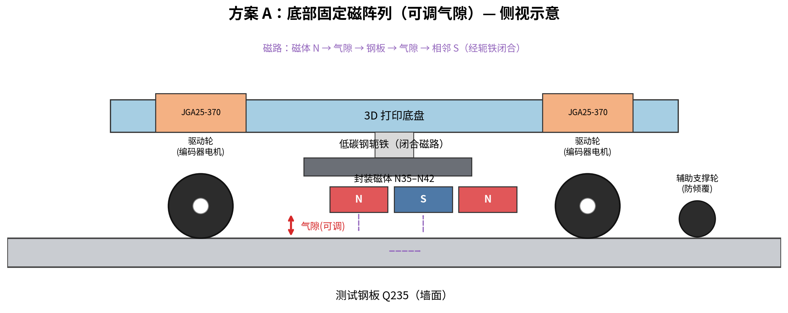

# system\_architecture

# system\_architecture.md — 赛道B 永磁吸附爬壁机器人（W1 结构力学）

> 负责人：何钰婷（Yuting1107）　|　分支：feat/yuting-w1-structure
> 对应 Issue：#2【W1】钢板规格、两方案对比、质量估算与受力计算
> 本文档是 W1 阶段成果，后续 W2–W3 再补充电源树、控制逻辑与风险图。

---

## 一、两套磁路方案对比（任务 4）

> 依据：手册 7.1「列出两种候选方案」、7.2 首版机构方案、5.5「对标部件—差异—风险—验证方式」。
> ✅ 已选定：**方案 A（底部固定磁阵列）**；方案 B 作为备选/对比项，用于说明设计理由。

### 方案 A：底部固定磁阵列（✅ 选定，手册首推）

- 结构：磁铁固定在底盘下方，通过**调节气隙**控制吸附力
- 优点：吸附力大且可调；磁阵列布局、轭铁材料可自由优化；结构简单、成本适中
- 缺点：磁吸增大会增加滚动/转向阻力；需额外可调气隙机构；磁体固定要防松脱、防夹伤

### 方案 B：磁轮方案（备选/对比）

- 结构：磁铁嵌进驱动轮，边走边吸附
- 优点：磁铁随轮运动，无需独立可调机构
- 缺点：磁铁接触面积小、吸附力受限；气隙由轮-板接触决定、难调；定制磁轮成本高

### 对比表（对齐 Issue 验收五列；参考初稿，请结合实际设计核实）

| 对比维度 | 方案 A（底部磁阵列，选定） | 方案 B（磁轮） |
| --- | --- | --- |
| 吸附方式 | 底盘下方磁阵列 + 可调气隙，吸附力大且可调 | 磁铁嵌驱动轮，边走边吸附，接触面积小 |
| 机构复杂度 | 中等（磁阵列 + 可调气隙机构） | 较高（定制磁轮轮毂） |
| 成本 | 适中 | 偏高 |
| 装配难度 | 中等（底盘开槽 + 磁体封装固定） | 较高（磁铁嵌轮、对中要求高） |
| 失败风险 | 磁体松脱/夹伤、气隙不一致 | 吸附力不足、磁轮摩擦损耗大、转向难 |

### 结构草图 ×2




> 草图要点：标出磁铁位置、气隙、轭铁、驱动轮、辅助轮。
> 说明：以方案 A 为实施对象，方案 B 用于 W6「改型对比」的对照，第 4 周前不必做成整机。
> 提示：示意图形式自定、手绘拍照即可，**不是评分项**（Issue 已注明）。

---

## 二、质量估算（任务 5）

> 依据：手册 7.5「计算整机质量、轮径、减速比和预计驱动力矩」。
> ⚠️ 本节为**估算值，非实测**（Issue 验收明确要求标注）；W3 装配后回填实测重量。

| 部件 | 数量 | 单件重量(g) | 小计(g) |
| --- | --- | --- | --- |
| JGA25-370 电机 | 2 | 待填 | 待填 |
| 电机驱动板 | 1 | 待填 | 待填 |
| ESP32 | 1 | 待填 | 待填 |
| 磁体小试样 | 待填 | 待填 | 待填 |
| 轭铁 | 1 | 待填 | 待填 |
| 驱动轮+辅助轮 | 4 | 待填 | 待填 |
| 3D 打印底盘 | 1 | 待填 | 待填 |
| 电池/其他 | 待填 | 待填 | 待填 |
| **总重 m** |   |   | **待填 g = \_\_\_**** kg** |

| 关键参数 | 取值 |
| --- | --- |
| 驱动轮半径 r | 待填（mm） |
| 减速比 i | 待填（如 1:30） |

---

## 三、受力计算（任务 6）

> 依据：手册 7.3-W1「绘制重力、法向磁吸力、摩擦和驱动力关系图」、7.5、6.5「静态抗滑最小条件 μ·FN ≥ m·g」。

### 4.1 已知参数

| 符号 | 含义 | 取值 |
| --- | --- | --- |
| m | 整机质量 | \_\_\_ kg（来自第三节） |
| g | 重力加速度 | 9.8 m/s² |
| μ | 轮胎-钢板静摩擦系数 | \_\_\_（参考 0.4–0.8，需实测） |
| r | 驱动轮半径 | \_\_\_ m（注意单位换算 mm→m） |
| i | 减速比 | \_\_\_ |

### 4.2 计算步骤

**① 重力**

```
G = m × g = ___ × 9.8 = ___ N
```

**② 垂直壁面不下滑的最小法向吸附力**

```
FN_min = G / μ = ___ / ___ = ___ N
FN_设计 = FN_min × 1.5~2  = ___ N（留安全裕度）
```

**③ 驱动力与驱动力矩**

```
驱动力 F_drive ≥ 滚动阻力 + 磁吸附加阻力 = ___ N
驱动力矩 T = F_drive × r = ___ N·m
```

**④ 电机转矩需求**

```
电机所需转矩 T_motor = T / (i × 效率) = ___ N·m
```

### 4.3 受力关系图与结论


> 图说明：机器人贴在垂直钢板（右侧）上，四力为——重力 G 竖直向下、法向磁吸力 F\_N 水平指向钢板、摩擦力 f 沿壁面向上、驱动力 F 沿壁面向上；左下角为四力关系式。

> 手册 7.5 关键结论：**磁力不是越大越好**——磁吸增加法向力，但也会增大转向及滚动阻力，影响电机选型。

- 我的结论（待填）：\_\_\_\_\_\_\_\_\_\_\_\_\_\_\_\_

---

## 四、下一步（W2 衔接）

- 低压台架验证电机正反转、编码器读数、通信超时停车（W2）
- 核查驱动器堵转电流
- 补充电源树、控制逻辑与风险图
