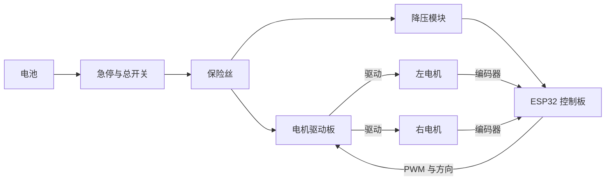

# 系统架构 — 赛道B 永磁吸附爬壁机器人

> 阶段：W1（四、五节为定性 v1，W2 补实测数值与引脚号）
> 对应 Issue：#2（一～三节，钢板规格、两方案对比、质量估算与受力计算）、#4（四、五节，系统图定性和风险图）

## 内容与分工

| 节 | 负责人 | 对应 Issue |
| --- | --- | --- |
| 一、两套磁路方案对比（任务 4） | 何钰婷 | #2 |
| 二、质量估算（任务 5） | 何钰婷 | #2 |
| 三、受力计算（任务 6） | 何钰婷 | #2 |
| 四、系统图 v1（定性） | 徐佳惠 | #4 |
| 五、风险图（定性） | 徐佳惠 | #4 |
| 六、下一步与待补清单（W2 衔接） | 全组 | — |

---

## 一、两套磁路方案对比（任务 4）

> 依据：手册 7.1「列出两种候选方案」、7.2 首版机构方案、5.5「对标部件—差异—风险—验证方式」。
> ✅ 已选定：**方案 A（底部固定磁阵列）**；方案 B 作为备选/对比项，用于说明设计理由。

### 方案 A：底部固定磁阵列（✅ 选定，手册首推）

- 结构：磁铁固定在底盘下方，通过**调节气隙**控制吸附力
- 优点：吸附力大且可调；磁阵列布局、轭铁材料可自由优化；结构简单、成本适中
- 缺点：磁吸增大会增加滚动/转向阻力；需额外可调气隙机构；磁体固定要防松脱、防夹伤

### 方案 B：磁轮方案（备选/对比）

- 结构：磁铁嵌进驱动轮，边走边吸附
- 优点：磁铁随轮运动，无需独立可调机构
- 缺点：磁铁接触面积小、吸附力受限；气隙由轮-板接触决定、难调；定制磁轮成本高

### 对比表（对齐 Issue 验收五列；参考初稿，请结合实际设计核实）

| 对比维度 | 方案 A（底部磁阵列，选定） | 方案 B（磁轮） |
| --- | --- | --- |
| 吸附方式 | 底盘下方磁阵列 + 可调气隙，吸附力大且可调 | 磁铁嵌驱动轮，边走边吸附，接触面积小 |
| 机构复杂度 | 中等（磁阵列 + 可调气隙机构） | 较高（定制磁轮轮毂） |
| 成本 | 适中 | 偏高 |
| 装配难度 | 中等（底盘开槽 + 磁体封装固定） | 较高（磁铁嵌轮、对中要求高） |
| 失败风险 | 磁体松脱/夹伤、气隙不一致 | 吸附力不足、磁轮摩擦损耗大、转向难 |

### 结构草图 ×2


> 草图要点：标出磁铁位置、气隙、轭铁、驱动轮、辅助轮。
> 说明：以方案 A 为实施对象，方案 B 用于 W6「改型对比」的对照，第 4 周前不必做成整机。
> 提示：示意图形式自定、手绘拍照即可，**不是评分项**（Issue 已注明）。

---

## 二、质量估算（任务 5）

> 依据：手册 7.5「计算整机质量、轮径、减速比和预计驱动力矩」。
> ⚠️ 本节为**估算值，非实测**（Issue 验收明确要求标注）；W3 装配后回填实测重量。

| 部件 | 数量 | 单件重量(g) | 小计(g) |
| --- | --- | --- | --- |
| JGA25-370 电机 | 2 | 待填 | 待填 |
| 电机驱动板 | 1 | 待填 | 待填 |
| ESP32 | 1 | 待填 | 待填 |
| 磁体小试样 | 待填 | 待填 | 待填 |
| 轭铁 | 1 | 待填 | 待填 |
| 驱动轮+辅助轮 | 4 | 待填 | 待填 |
| 3D 打印底盘 | 1 | 待填 | 待填 |
| 电池/其他 | 待填 | 待填 | 待填 |
| **总重 m** |   |   | **待填 g = \_\_\_**** kg** |

| 关键参数 | 取值 |
| --- | --- |
| 驱动轮半径 r | 待填（mm） |
| 减速比 i | 待填（如 1:30） |

---

## 三、受力计算（任务 6）

> 依据：手册 7.3-W1「绘制重力、法向磁吸力、摩擦和驱动力关系图」、7.5、6.5「静态抗滑最小条件 μ·FN ≥ m·g」。

### 3.1 已知参数

| 符号 | 含义 | 取值 |
| --- | --- | --- |
| m | 整机质量 | \_\_\_ kg（来自第三节） |
| g | 重力加速度 | 9.8 m/s² |
| μ | 轮胎-钢板静摩擦系数 | \_\_\_（参考 0.4–0.8，需实测） |
| r | 驱动轮半径 | \_\_\_ m（注意单位换算 mm→m） |
| i | 减速比 | \_\_\_ |

### 3.2 计算步骤

**① 重力**

```
G = m × g = ___ × 9.8 = ___ N
```

**② 垂直壁面不下滑的最小法向吸附力**

```
FN_min = G / μ = ___ / ___ = ___ N
FN_设计 = FN_min × 1.5~2  = ___ N（留安全裕度）
```

**③ 驱动力与驱动力矩**

```
驱动力 F_drive ≥ 滚动阻力 + 磁吸附加阻力 = ___ N
驱动力矩 T = F_drive × r = ___ N·m
```

**④ 电机转矩需求**

```
电机所需转矩 T_motor = T / (i × 效率) = ___ N·m
```

### 3.3 受力关系图与结论


> 图说明：机器人贴在垂直钢板（右侧）上，四力为——重力 G 竖直向下、法向磁吸力 F\_N 水平指向钢板、摩擦力 f 沿壁面向上、驱动力 F 沿壁面向上；左下角为四力关系式。

> 手册 7.5 关键结论：**磁力不是越大越好**——磁吸增加法向力，但也会增大转向及滚动阻力，影响电机选型。

- 我的结论（待填）：\_\_\_\_\_\_\_\_\_\_\_\_\_\_\_\_

---

## 四、系统图 v1（定性）

> 本图按手册 7.2 建议的「两驱动轮＋辅助支撑轮＋可调气隙底部磁阵列」方案绘制。
> 若最终选四驱方案，驱动板通道数与电机节点需相应增加。
> **v1 不标电流值、不标引脚号**——那些要等 W2 实测和接线完成后补。

### 4.1 电源树与控制逻辑



### 4.2 设计说明

1. **急停放在电池之后、保险丝之前**：按下即切断全部供电，不依赖软件。手册 10.1 要求「独立停机位置」，10.2 表 14 禁止「靠软件停机代替防坠」。
2. **保险丝在驱动板之前**：保护主回路，防止堵转或短路时过流。手册 10.3「上电前六步」第 2 条要求保护器件与限流设置。
3. **编码器信号回主控、不直连驱动板**：速度由主控计算（用于差速与闭环），驱动板只负责功率输出。
4. **降压模块单独从保险丝后取电**：避免电机大电流导致主控复位。

### 4.3 待 W2 确认

- 降压模块前是否再加独立开关
- 电池选 3S 还是其他电压等级（待 W2 实测总电流后定）
- 急停只断主回路，还是同时断控制回路
- 编码器 A/B 相是否都接中断（影响引脚分配）
- 驱动板通道数：2 路还是 4 路（取决于最终机构方案）

---

## 五、风险图（定性）

> 依据手册第 10 章表 14「五类高风险操作」与 7.4 停机条件。

### 5.1 五类危险源与本组的对应关系

| 手册五类危险源 | 与本组的关系 |
| --- | --- |
| 锂电池与动力供电 | 相关——本组用电池组供电 |
| EDF 高速风机 | **不适用**，本组无此设备 |
| 永磁体 | **高度相关**——磁阵列安装与拆装 |
| 四足舵机/机械 | 对应本组的电机堵转与机械夹点 |
| 垂直爬壁 | **高度相关**——贴竖直板运行、台架倾倒 |

### 5.2 风险处置表

| 危险源 | 触发条件 | 处置动作 | 停机方式 | 负责人 |
| --- | --- | --- | --- | --- |
| 锂电池鼓包/异常发热 | 充电或放电中电池发烫、变形、有异味 | 立即断电，移到空旷无易燃物处隔离，报告老师；不徒手触碰 | 拔插头 / 断总开关 | 待定 |
| 磁体夹伤 | 安装、拆装、两块磁体靠近时 | 戴护目镜，用垫木或非磁性工具分隔，一次只操作一片 | 断电后处理 | 待定 |
| 磁体崩裂 | 磁体受撞击或硬掰 | 停止使用该片，清理碎片（戴手套），检查同批磁体 | 断电后处理 | 待定 |
| 电机堵转 | 车轮卡死仍持续通电 | 立即断电，用手转动确认是否卡死，再测堵转电流 | 按急停 | 待定 |
| 异常滑移 | 磁力不足，车沿板面下滑 | 人员立即离开板下方，断电后检查气隙与磁阵列 | 按急停 | 待定 |
| 台架倾倒 / 防坠松脱 | 钢板固定松动、台架受力变形 | 撤离并隔离危险区，按学校应急流程处理 | 独立防坠 + 急停 | 待定 |

### 5.3 立即停止条件（手册 7.4）

出现以下任一情况，立即停止实验并记录原因：

- 磁铁松脱或破裂
- 存在夹伤风险
- 电机堵转
- 异常滑移
- 防坠装置松脱

### 5.4 授权需求（供附件 B1 填写）

- **垂直运动**（W6 进阶项）：需专项批准，且在防坠台架上进行
- **强磁体操作**：需教师准入后操作，使用封装小尺寸磁体
- **拉力计与爬壁台架**：使用前需向中心询问

---

## 六、下一步与待补清单（W2 衔接）

### 6.1 W2 要做的
- 低压台架验证电机正反转、编码器读数、通信超时停车
- 核查驱动板堵转电流（实测值回填 BOM 第 2 节）

### 6.2 本文档待补的字段
| 内容 | 什么时候补 |
| --- | --- |
| 电源树填实测电流、电池型号、线径 | W2 实测后 |
| 控制逻辑图填引脚号 | W2 接线后 |
| 加入限速与失联停车的说明 | W2 实现后 |
| G2 中期验收自查结论 | W4 |
